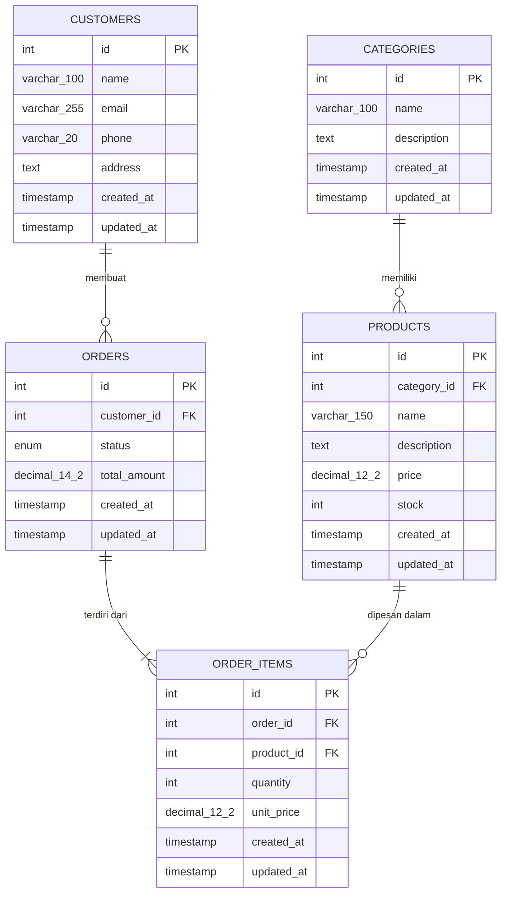

# ERD — E-Commerce

Dokumen ini menjelaskan rancangan database: entitas, atribut, primary key, foreign key, relasi, dan alasan pemilihan nama kolom. Rancangan disusun dari DTO yang sudah dibuat (`Category`, `Customer`, `Product`, `Order`, `OrderItem`).

## 1. Diagram (Mermaid)



Arti simbol: `||` tepat satu, `o{` nol atau banyak, `|{` satu atau banyak.

## 2. Relasi

| Relasi | Kardinalitas | Foreign key | Aturan hapus | Penjelasan |
|---|---|---|---|---|
| categories — products | 1 : N | `products.category_id` | RESTRICT | Satu kategori punya banyak produk; satu produk hanya di satu kategori |
| customers — orders | 1 : N | `orders.customer_id` | RESTRICT | Satu pelanggan bisa punya banyak pesanan |
| orders — order_items | 1 : N (minimal 1) | `order_items.order_id` | CASCADE | Satu pesanan wajib punya minimal satu item (sesuai `@ArrayMinSize(1)`) |
| products — order_items | 1 : N | `order_items.product_id` | RESTRICT | Satu produk bisa muncul di banyak item pesanan |

`RESTRICT` artinya induk tidak bisa dihapus selama masih punya anak, sehingga riwayat pesanan tidak rusak. `CASCADE` dipakai pada `order_items.order_id` karena item adalah bagian dari pesanan: kalau pesanan dihapus, item-nya ikut terhapus.

**Orders dan products adalah hubungan many-to-many** (satu pesanan berisi banyak produk, satu produk dipesan di banyak pesanan). Hubungan ini dipecah lewat tabel penghubung `order_items` yang juga membawa data tambahan (`quantity`, `unit_price`).

## 3. Kamus Data

### Tabel `categories`

| Key | Kolom | Tipe data | Keterangan |
|---|---|---|---|
| PK | `id` | integer | auto increment |
|  | `name` | varchar(100) | UNIQUE, NOT NULL |
|  | `description` | text | NULL (boleh kosong) |
|  | `created_at` | timestamp | otomatis saat data dibuat |
|  | `updated_at` | timestamp | otomatis saat data diubah |

### Tabel `customers`

| Key | Kolom | Tipe data | Keterangan |
|---|---|---|---|
| PK | `id` | integer | auto increment |
|  | `name` | varchar(100) | NOT NULL |
|  | `email` | varchar(255) | UNIQUE, NOT NULL |
|  | `phone` | varchar(20) | NULL (boleh kosong) |
|  | `address` | text | NULL (boleh kosong) |
|  | `created_at` | timestamp | otomatis |
|  | `updated_at` | timestamp | otomatis |

### Tabel `products`

| Key | Kolom | Tipe data | Keterangan |
|---|---|---|---|
| PK | `id` | integer | auto increment |
| FK | `category_id` | integer | NOT NULL, ON DELETE RESTRICT |
|  | `name` | varchar(150) | NOT NULL |
|  | `description` | text | NULL (boleh kosong) |
|  | `price` | decimal(12,2) | NOT NULL, harus > 0, maksimal 2 angka desimal |
|  | `stock` | integer | NOT NULL, harus >= 0 |
|  | `created_at` | timestamp | otomatis |
|  | `updated_at` | timestamp | otomatis |

### Tabel `orders`

| Key | Kolom | Tipe data | Keterangan |
|---|---|---|---|
| PK | `id` | integer | auto increment |
| FK | `customer_id` | integer | NOT NULL, ON DELETE RESTRICT |
|  | `status` | enum | NOT NULL, DEFAULT PENDING (lihat enum di bawah) |
|  | `total_amount` | decimal(14,2) | NOT NULL, dihitung sistem dari jumlah `quantity × unit_price` |
|  | `created_at` | timestamp | otomatis |
|  | `updated_at` | timestamp | otomatis |

### Tabel `order_items`

| Key | Kolom | Tipe data | Keterangan |
|---|---|---|---|
| PK | `id` | integer | auto increment |
| FK | `order_id` | integer | NOT NULL, ON DELETE CASCADE |
| FK | `product_id` | integer | NOT NULL, ON DELETE RESTRICT |
| UNIQUE | (`order_id`, `product_id`) |  | Kombinasi order dan produk harus unik (tidak boleh produk sama dua kali dalam satu pesanan) |
|  | `quantity` | integer | NOT NULL, harus >= 1 |
|  | `unit_price` | decimal(12,2) | NOT NULL, harga produk saat pesanan dibuat (snapshot) |
|  | `created_at` | timestamp | otomatis |
|  | `updated_at` | timestamp | otomatis |

Enum: `order_status_enum` = PENDING, PAID, SHIPPED, COMPLETED, CANCELLED.

> **Catatan:** Pastikan nilai enum `order_status_enum` di database SELALU sama persis dengan enum `OrderStatus` di `order.entity.ts`. Jika Anda menambah/mengubah status di kode, update juga enum di database dan dokumentasi ini agar tidak terjadi mismatch status.

Index tambahan:

- `IDX_orders_customer_status` pada (`customer_id`, `status`) untuk mempercepat filter di `QueryOrderDto`.
- `IDX_order_items_order_id` pada (`order_id`) dan `IDX_order_items_product_id` pada (`product_id`) untuk mempercepat join.
- `IDX_products_category_id` pada (`category_id`) untuk mempercepat pencarian produk per kategori.

## 4. Pemetaan DTO ke Kolom

| DTO | Field | Validasi di DTO | Hasil di database |
|---|---|---|---|
| `CreateCategoryDto` | `name` | `@IsString`, `@IsNotEmpty`, `@MaxLength(100)` | `categories.name` varchar(100) NOT NULL |
| `CreateCategoryDto` | `description` | `@IsOptional`, `@IsString` | `categories.description` text NULL |
| `CreateCustomerDto` | `name` | `@IsNotEmpty`, `@MaxLength(100)` | `customers.name` varchar(100) NOT NULL |
| `CreateCustomerDto` | `email` | `@IsEmail`, `@IsNotEmpty` | `customers.email` varchar(255) UNIQUE NOT NULL |
| `CreateCustomerDto` | `phone` | `@IsOptional`, `@MaxLength(20)` | `customers.phone` varchar(20) NULL |
| `CreateCustomerDto` | `address` | `@IsOptional`, `@IsString` | `customers.address` text NULL |
| `CreateProductDto` | `categoryId` | `@IsInt`, `@IsPositive` | `products.category_id` integer FK NOT NULL |
| `CreateProductDto` | `name` | `@IsNotEmpty`, `@MaxLength(150)` | `products.name` varchar(150) NOT NULL |
| `CreateProductDto` | `description` | `@IsOptional`, `@IsString` | `products.description` text NULL |
| `CreateProductDto` | `price` | `@IsNumber({ maxDecimalPlaces: 2 })`, `@IsPositive` | `products.price` decimal(12,2), CHECK > 0 |
| `CreateProductDto` | `stock` | `@IsInt`, `@Min(0)` | `products.stock` integer, CHECK >= 0 |
| `CreateOrderDto` | `customerId` | `@IsInt` | `orders.customer_id` integer FK NOT NULL |
| `CreateOrderDto` | `items` | `@IsArray`, `@ArrayMinSize(1)`, `@ValidateNested` | baris-baris di `order_items` (minimal 1) |
| `CreateOrderItemDto` | `productId` | `@IsInt` | `order_items.product_id` integer FK NOT NULL |
| `CreateOrderItemDto` | `quantity` | `@IsInt`, `@Min(1)` | `order_items.quantity` integer, CHECK >= 1 |
| `UpdateOrderStatusDto` | `status` | `@IsEnum(OrderStatus)` | `orders.status` enum |
| `QueryOrderDto` | `customerId`, `status` | `@IsOptional` | filter pada `orders`, didukung index (`customer_id`, `status`) |

`UpdateCategoryDto`, `UpdateCustomerDto`, dan `UpdateProductDto` memakai `PartialType`, jadi semua field-nya opsional dan tidak menambah kolom baru.

## 5. Alasan Pemilihan Nama Kolom dan Tipe Data

| Pilihan | Alasan |
|---|---|
| Nama tabel jamak `snake_case` huruf kecil | Kebiasaan umum PostgreSQL (tanpa tanda kutip). Nama `orders` dipilih karena `order` adalah kata kunci SQL dan akan bermasalah jika dipakai sebagai nama tabel |
| Nama kolom `snake_case` di database, `camelCase` di TypeScript | Keduanya dihubungkan oleh `@Column({ name: '...' })`, misalnya `customerId` di kode menjadi `customer_id` di database |
| `id` bertipe `integer` auto increment | DTO memvalidasi `customerId`, `productId`, dan `category_id` dengan `@IsInt()`, sehingga ID harus berupa angka, bukan UUID |
| `name` `varchar(100)` / `varchar(150)` | Mengikuti `@MaxLength` pada DTO masing-masing |
| `email` UNIQUE | Satu email hanya milik satu pelanggan, juga mencegah pendaftaran ganda |
| `phone` `varchar(20)` | Nomor telepon bukan untuk dihitung; disimpan sebagai teks agar angka 0 di depan dan tanda `+` tidak hilang |
| `description`, `address` `text` | Isinya bisa panjang dan tidak ada batas di DTO |
| `price` `decimal(12,2)` | Uang tidak boleh memakai `float` karena bisa menimbulkan selisih pembulatan; 2 angka desimal sesuai `maxDecimalPlaces: 2` |
| `stock` `integer` + CHECK >= 0 | Database sendiri menolak stok negatif, sebagai pengaman kedua selain `@Min(0)` |
| `status` enum | Alur status pesanan terbatas; database menolak nilai di luar daftar |
| `total_amount` di `orders` | DTO tidak menerima total dari klien, jadi dihitung server agar tidak bisa dimanipulasi |
| `unit_price` di `order_items` | Menyimpan harga saat pesanan dibuat. Tanpa ini, perubahan `products.price` akan mengubah nilai pesanan lama |
| `order_items` sebagai tabel terpisah | Satu pesanan berisi banyak produk (array `items` di `CreateOrderDto`), sehingga perlu tabel penghubung |
| `created_at`, `updated_at` | Jejak waktu otomatis (audit sederhana) |

## 6. Asumsi dan Hal yang Perlu Disesuaikan

Beberapa bagian tidak terlihat langsung dari DTO, jadi saya mengisinya dengan asumsi. Mohon dicocokkan dengan entity yang sebenarnya.

1. **Nilai `OrderStatus`** tidak terlihat di DTO (hanya diimpor dari `order.entity.ts`). Saya memakai PENDING, PAID, SHIPPED, COMPLETED, CANCELLED. Ganti sesuai isi enum Anda.
4. **`customers.email` `varchar(255)`** karena DTO tidak memberi `@MaxLength`.  
   > **Catatan:** Sebaiknya tambahkan validasi `@MaxLength(255)` pada field `email` di DTO agar tidak terjadi error jika data yang dimasukkan melebihi 255 karakter.
7. **Kolom `decimal` di TypeORM** dikembalikan sebagai `string`, bukan `number`. Tambahkan `transformer` pada `@Column` untuk `price`, `unit_price`, dan `total_amount` agar sesuai dengan `@IsNumber()` di DTO.

   Contoh penggunaan transformer di entity TypeORM:
   ```typescript
   // Di file entity, misal product.entity.ts
   import { Column } from 'typeorm';

   const decimalTransformer = {
     to: (value: number) => value,
     from: (value: string) => parseFloat(value),
   };

   @Column({ type: 'decimal', precision: 12, scale: 2, transformer: decimalTransformer })
   price: number;
   ```
   Terapkan juga pada kolom `unit_price` dan `total_amount` di entity terkait.
4. **`customers.email` `varchar(255)`** karena DTO tidak memberi `@MaxLength`.
5. **Item ganda dalam satu pesanan**: DTO tidak mencegah `productId` yang sama muncul dua kali di `items`. Gabungkan di service, atau tambahkan UNIQUE (`order_id`, `product_id`) di database.
6. **Pengurangan stok** saat pesanan dibuat sebaiknya dilakukan dalam satu transaksi database bersama pembuatan `orders` dan `order_items`, agar stok tidak berkurang jika pembuatan pesanan gagal.
7. **Kolom `decimal` di TypeORM** dikembalikan sebagai `string`, bukan `number`. Tambahkan `transformer` pada `@Column` untuk `price`, `unit_price`, dan `total_amount` agar sesuai dengan `@IsNumber()` di DTO.
8. **Konsistensi penamaan field DTO**: `CreateProductDto` sekarang memakai `categoryId` (camelCase), sama seperti DTO lain yang memakai `customerId` dan `productId`. Ini membuat penamaan konsisten dan memudahkan mapping.
9. **Import tidak terpakai**: `IsUUID` diimpor di `create-order-item.dto.ts` tetapi tidak dipakai, dan bisa dihapus.

## 7. Gambaran SQL Setara (ilustrasi)

TypeORM membuat tabel otomatis (`synchronize`). SQL berikut hanya gambaran agar mudah dibaca; nama constraint asli buatan TypeORM berbentuk hash.

```sql
CREATE TYPE order_status_enum AS ENUM ('PENDING','PAID','SHIPPED','COMPLETED','CANCELLED');

CREATE TABLE categories (
  id serial PRIMARY KEY,
  name varchar(100) NOT NULL UNIQUE,
  description text,
  created_at timestamp NOT NULL DEFAULT now(),
  updated_at timestamp NOT NULL DEFAULT now()
);

CREATE TABLE customers (
  id serial PRIMARY KEY,
  name varchar(100) NOT NULL,
  email varchar(255) NOT NULL UNIQUE,
  phone varchar(20),
  address text,
  created_at timestamp NOT NULL DEFAULT now(),
  updated_at timestamp NOT NULL DEFAULT now()
);

CREATE TABLE products (
  id serial PRIMARY KEY,
  category_id integer NOT NULL REFERENCES categories(id) ON DELETE RESTRICT,
  name varchar(150) NOT NULL,
  description text,
  price numeric(12,2) NOT NULL CHECK (price > 0),
  stock integer NOT NULL CHECK (stock >= 0),
  created_at timestamp NOT NULL DEFAULT now(),
  updated_at timestamp NOT NULL DEFAULT now()
);
CREATE INDEX "IDX_products_category_id" ON products (category_id);

CREATE TABLE orders (
  id serial PRIMARY KEY,
  customer_id integer NOT NULL REFERENCES customers(id) ON DELETE RESTRICT,
  status order_status_enum NOT NULL DEFAULT 'PENDING',
  total_amount numeric(14,2) NOT NULL DEFAULT 0,
  created_at timestamp NOT NULL DEFAULT now(),
  updated_at timestamp NOT NULL DEFAULT now()
CREATE TABLE order_items (
  id serial PRIMARY KEY,
  order_id integer NOT NULL REFERENCES orders(id) ON DELETE CASCADE,
  product_id integer NOT NULL REFERENCES products(id) ON DELETE RESTRICT,
  quantity integer NOT NULL CHECK (quantity >= 1),
  unit_price numeric(12,2) NOT NULL CHECK (unit_price > 0),
  created_at timestamp NOT NULL DEFAULT now(),
  updated_at timestamp NOT NULL DEFAULT now(),
  CONSTRAINT unique_order_product UNIQUE (order_id, product_id)
);
CREATE INDEX "IDX_order_items_order_id" ON order_items (order_id);
CREATE INDEX "IDX_order_items_product_id" ON order_items (product_id);
);
CREATE INDEX "IDX_order_items_order_id" ON order_items (order_id);
CREATE INDEX "IDX_order_items_product_id" ON order_items (product_id);
```
